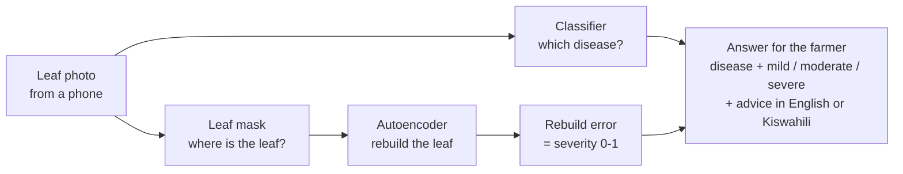
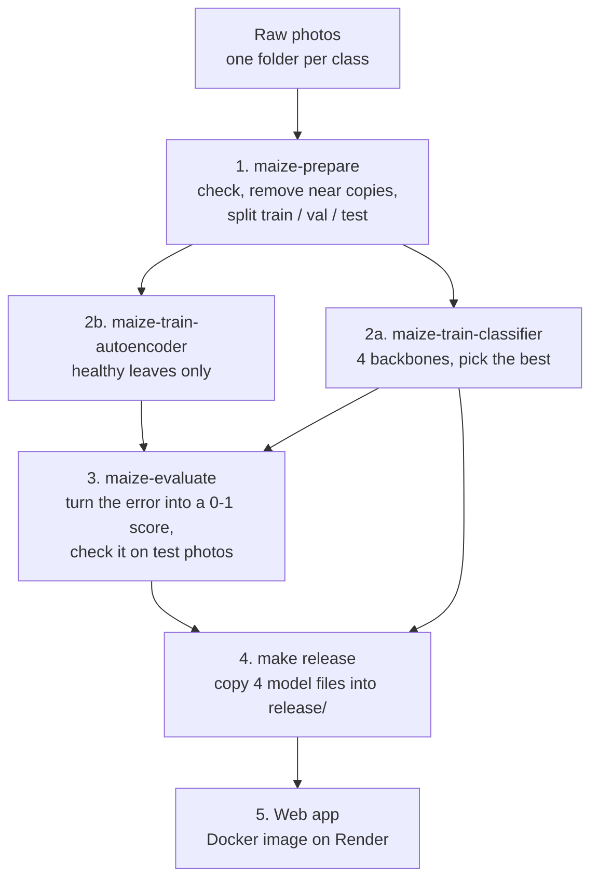
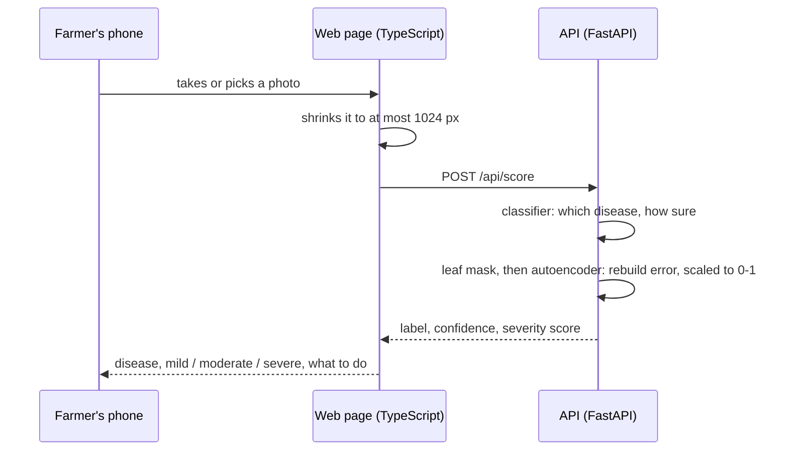

# How MaizeCare works

This page explains the system in plain words. The commands are in the [README](README.md).

## The big picture

A farmer takes a photo of a maize leaf, and the app answers two questions:

1. **Which disease is it?** Healthy, Maize Leaf Blight (MLB), Maize Lethal Necrosis (MLND) or Maize Streak Virus (MSV).
2. **How bad is it?** A severity score from 0 to 1, shown as mild, moderate or severe.

Each question has its own model. I trained both once on Google Colab, and the web app runs the saved files.



## The two models

**The classifier** is MobileNetV2, a small network that learned from everyday photos (ImageNet) before I taught it
the four maize classes. It looks at the whole photo. If it's less than 60% sure, the app asks the farmer for another
photo instead of guessing.

**The autoencoder** has only ever seen healthy leaves. It squeezes a leaf down into a small code and then tries to
rebuild it. Healthy leaves come back well and diseased ones come back badly, so how badly it rebuilds a leaf tells
us how severe the damage is. The nice thing is that this needs no severity labels, which we don't have.

### Why the leaf mask?

Field photos are full of soil, weeds and other leaves. The autoencoder should only judge the leaf itself, so we find
it first. The farmer aims the camera at the leaf, so GrabCut starts from the middle of the photo and grows outward
until the colours change. Everything outside that mask is ignored.

## From raw photos to a running app



| Step | What happens | Why |
|---|---|---|
| 1. Prepare | Broken and tiny images are dropped. Photos of the same leaf are grouped, and whole groups are split 70 / 15 / 15 into train, val and test. Photos are resized and their leaf masks found once, then cached on Drive. | If the same leaf showed up in both training and test, the test score would look better than it really is. |
| 2a. Classifier | MobileNetV2, MobileNetV3-Small, EfficientNet-B0 and ResNet50 are trained the same way, and the best one on val is kept. | A small model that's almost as good as a big one runs quickly on a free server. |
| 2b. Autoencoder | A plain and a variational autoencoder are trained on healthy leaves, and I keep the one that best tells healthy leaves from diseased ones on val. | There are no severity labels, so "how unlike a healthy leaf" stands in for severity. |
| 3. Evaluate | The 0-1 scale is set on val. On test, I check whether the score separates healthy from diseased leaves, and whether it agrees with how much of the leaf is yellow or brown. | The test photos are only used once, right at the end. |
| 4. Release | `classifier.onnx`, `classifier.json`, `model.onnx` and `calibration.json` are copied into `release/`. | Those four files are everything the app needs. |
| 5. App | FastAPI serves both the API and the web page from one Docker image. | One small container fits Render's free plan. |

## What happens when a farmer uploads a photo



The photo is handled in memory and never saved.

## Where the code lives

```
src/maize/
  preprocess.py   one photo -> model input + leaf mask (shared by training and the app, so both see the same pixels)
  pipeline.py     step 1: the data pipeline, the manifest and the image cache
  classifier.py   step 2a
  autoencoder.py  step 2b
  evaluate.py     step 3
  serve.py        step 5: the API
frontend/         the web page (TypeScript, English and Kiswahili)
notebooks/        the results notebook: every step above, run on the trained models, nothing retrained
tests/            automated tests for every module
```

## A few design choices

- **ONNX in production.** Both models are exported to ONNX and run with `onnxruntime`. The server doesn't need
  PyTorch, TensorFlow or Keras, which keeps the image under Render's free 512 MB.
- **One shared preprocessing file.** Training, evaluation and the app all go through `preprocess.py`, so a photo is
  resized and masked exactly the same way everywhere.
- **Reproducible from end to end.** `pyproject.toml` lists the dependencies, `uv.lock` pins their exact versions,
  and every split and seed is fixed. CI runs the tests on every push, and Render redeploys `main` on its own.
