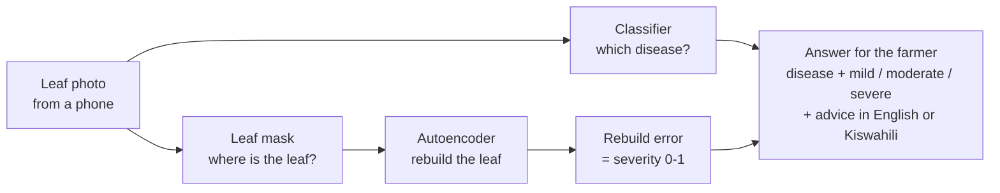
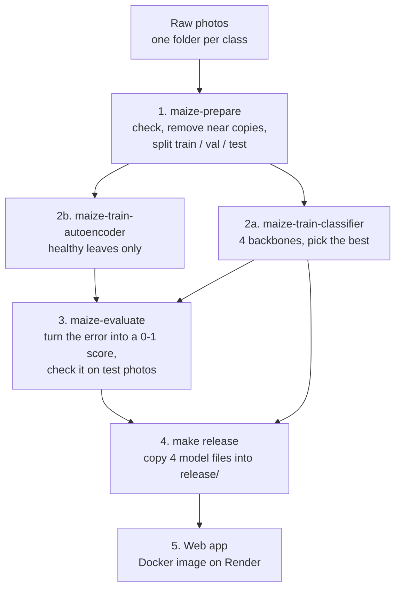
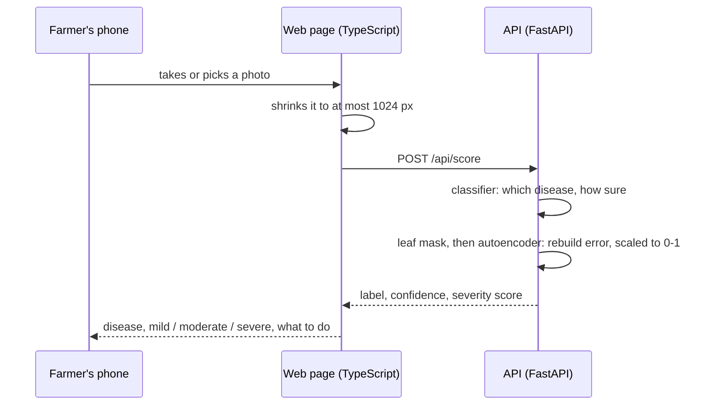

# How MaizeCare works

This page explains the system in plain words. For the commands, see the [README](README.md).

## The big picture

A farmer takes a photo of a maize leaf. The app answers two questions:

1. **Which disease is it?** Healthy, Maize Leaf Blight (MLB), Maize Lethal Necrosis (MLND) or Maize Streak Virus (MSV).
2. **How bad is it?** A severity score from 0 to 1, shown as mild, moderate or severe.

Two models answer these questions, one each. Both are trained once on Google Colab, and the web app runs the trained
files.



## The two models, in one sentence each

- **The classifier** is MobileNetV2, a small network pre-trained on everyday photos (ImageNet) and then taught the
  four maize classes. It looks at the whole photo. If it is less than 60% sure, the app asks the farmer to take
  another photo instead of guessing.
- **The autoencoder** has only ever seen **healthy** leaves. It squeezes a leaf into a small code and tries to
  rebuild it. It rebuilds healthy leaves well and diseased leaves badly, so *how badly* it rebuilds a leaf is
  the severity. This needs no severity labels, which we do not have.

### Why a leaf mask?

Field photos show soil, weeds and other leaves around the leaf. The autoencoder should only judge the leaf, so
we first find it: the farmer aims the camera at the leaf, so GrabCut starts from the middle of the photo and grows
outwards to where the colours change. Everything outside the mask is ignored.

## From raw photos to a running app



| Step | What it does | Why |
|---|---|---|
| 1. Prepare | Drops broken and tiny images. Groups near-identical photos (the same leaf shot twice). Splits whole groups 70 / 15 / 15 into train, val and test. Resizes photos and finds the leaf masks once, then caches them on Drive. | If the same leaf were in training and in test, the test score would be too good to be true. |
| 2a. Classifier | Trains MobileNetV2, MobileNetV3-Small, EfficientNet-B0 and ResNet50 the same way, and keeps the best on val. | A small model that is nearly as good as a big one runs fast on a free server. |
| 2b. Autoencoder | Trains a plain and a variational autoencoder on healthy leaves, and keeps the one that best separates healthy from diseased val leaves. | No severity labels exist, so "how unlike a healthy leaf" stands in for severity. |
| 3. Evaluate | Sets the 0-1 scale on val. Checks on test whether the score separates healthy from diseased leaves and whether it agrees with the share of the leaf that is yellow or brown. | The test photos are used once, at the end. |
| 4. Release | Copies `classifier.onnx`, `classifier.json`, `model.onnx` and `calibration.json` into `release/`. | These four files are all the app needs. |
| 5. App | FastAPI serves the API and the web page from one Docker image. | One small container fits Render's free plan. |

## What happens when a farmer uploads a photo



The photo is processed in memory and never stored.

## Where the code lives

```
src/maize/
  preprocess.py   one photo -> model input + leaf mask (shared by training and the app, so both see the same pixels)
  pipeline.py     step 1: the data pipeline, the manifest and the image cache
  classifier.py   step 2a
  autoencoder.py  step 2b
  evaluate.py     step 3
  serve.py        step 5: the API
frontend/         the web page (TypeScript, English and Kiswahili)
notebooks/        the results notebook: every step above, shown with the trained models, nothing retrained
tests/            automated tests for every module
```

## Design choices worth knowing

- **ONNX in production.** Both models are exported to ONNX and run with `onnxruntime`. The server needs no PyTorch,
  TensorFlow or Keras, so the image stays under Render's free 512 MB.
- **One shared preprocessing file.** Training, evaluation and the app all call `preprocess.py`, so a photo is
  resized and masked the same way everywhere.
- **Everything is reproducible.** `pyproject.toml` lists the dependencies, `uv.lock` pins their exact versions, and
  every split and seed is fixed. CI runs the tests on every push and deploys `main` to Render.
