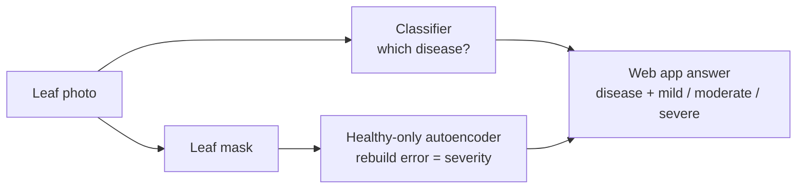

# MaizeCare

Maize feeds most of East Africa, and a leaf disease can wipe out a big part of a harvest. When a farmer finds a sick
leaf, they really want to know two things: what is it, and how bad is it? MaizeCare answers both from one phone
photo, in English or Kiswahili.

1. **Which disease?** A MobileNetV2 classifier, fine-tuned from ImageNet, decides between Healthy, Maize Leaf
   Blight (MLB), Maize Lethal Necrosis (MLND) and Maize Streak Virus (MSV). If it isn't sure, it asks for a better
   photo rather than guessing.
2. **How bad?** An autoencoder that has only ever seen healthy leaves tries to rebuild the leaf in the photo. The
   worse it does, the sicker the leaf. That gives a severity score from 0 to 1 without needing any severity labels,
   which don't exist for East African maize.

If you're new to the project, start with [ARCHITECTURE.md](ARCHITECTURE.md), which walks through the system with
simple diagrams. The [results notebook](notebooks/maizecare.ipynb) then shows every step running on the trained
models.



## What's in the repository

| Deliverable | Where to find it |
|---|---|
| Overview, setup and how to reproduce | this README |
| Architecture diagram | above, and in [ARCHITECTURE.md](ARCHITECTURE.md) |
| Disclosure of AI assistance | [AI_USE.md](AI_USE.md) |
| Data pipeline | [`src/maize/pipeline.py`](src/maize/pipeline.py), run with `maize-prepare` |
| Model training code | [`classifier.py`](src/maize/classifier.py), [`autoencoder.py`](src/maize/autoencoder.py), [`evaluate.py`](src/maize/evaluate.py) |
| Trained models | [`release/`](release/): `classifier.onnx`, `classifier.json`, `model.onnx`, `calibration.json` |
| Dockerfile | [`Dockerfile`](Dockerfile) |
| API service | [`src/maize/serve.py`](src/maize/serve.py), built with FastAPI |
| Results and figures | the [results notebook](notebooks/maizecare.ipynb) |

```
src/maize/
  preprocess.py   one photo -> model input + leaf mask; shared by training and the web app
  pipeline.py     the data pipeline (DataPipeline), the manifest and the image cache   (no torch)
  classifier.py   stage 1: Keras CNN, 4 backbones compared, exported to ONNX
  autoencoder.py  stage 2: masked convolutional and variational autoencoders, exported to ONNX
  evaluate.py     severity score calibrated on val, checked on test against A(x)
  serve.py        FastAPI app: /api/score + the built frontend                         (no torch)
frontend/         plain TypeScript UI (English + Kiswahili), compiled to static files
notebooks/        the results notebook (runs everything except training)
tests/            pytest suite
```

## Running the app

The quickest way is Docker. The four model files are already in `release/`.

```bash
make docker                    # builds the image and runs it; then open http://localhost:8000
```

If you'd rather not use Docker, you need Python 3.12+ and Node 24:

```bash
make install                   # the package with the data and serve extras, plus dev tools
make serve                     # builds the frontend and serves http://localhost:8000
make test                      # runs the test suite
```

The app also starts without model files. In that case `/api/score` answers 503 until you add them.

## Reproducing everything from scratch

I kept the data, the image caches and the trained models on Google Drive, so a Colab session that dies halfway
loses nothing. Training needs a GPU (I used an L4); everything else runs fine on a CPU.

```bash
cd /content && git clone https://github.com/Kos-en/maizecare repo && cd repo
pip install -q --no-deps -e . && pip install -q imagehash onnx onnxscript onnxruntime
export KERAS_BACKEND=torch D=/content/drive/MyDrive M=/content/drive/MyDrive/maize_models

maize-prepare $D/cv_datasets_cleaned $D                     # 1. data pipeline (CPU is enough)
maize-train-classifier $D $M                                # 2a. all 4 backbones -> $M/classifiers.csv
maize-train-autoencoder $D $M                               # 2b. conv + VAE      -> $M/autoencoders.csv
maize-evaluate $D $M $M/clf_mobilenet_v2                    # 3. calibrate on val, report on test
```

When that's done, copy the four files the app needs into `release/` and commit them:

```bash
make release MODELS=<your maize_models folder> CLF=clf_mobilenet_v2 AE=v2/ae_<chosen kind>
```

Run any of these commands without arguments and it prints how to use it. The seed is fixed at 42 and the split is
deterministic, so the same photos always give the same split and comparable models.

To see the results without retraining anything, open [`notebooks/maizecare.ipynb`](notebooks/maizecare.ipynb) in
Colab (File -> Upload notebook) and choose Runtime -> Run all. It loads the trained models from Drive and goes
through the data, the exploratory analysis, both models, the test results and the full pipeline on test photos.

## The data pipeline: `maize-prepare`

Every photo goes through the same steps before any training, and photos added later get exactly the same
treatment.

```bash
maize-prepare RAW ROOT       # RAW/<Class>/*.jpg; re-run after adding photos
```

1. **File check.** A file has to open as a JPEG or PNG, and its shortest side has to be at least 50 px. Anything
   else is marked `bad_image` or `too_small`.
2. **Near copies.** Two photos count as near copies when they are within 6 bits on both pHash and aHash, and chains
   of near copies become one group. I first tried either hash on its own, and it chained 18,624 unrelated photos
   into a single group, so both hashes have to agree.
3. **Mixed labels.** If a group holds two classes, the whole group is dropped (`label_conflict`). Exact copies keep
   just one photo (`duplicate_exact`).
4. **Split by group, per class.** Within each class, the groups are sorted in a fixed (hash) order and fill test,
   val and train until they hold 15%, 15% and 70% of that class. Because whole groups move together, the same leaf
   can never end up in both training and test, and a leak check at the end confirms it.
5. **Resize and leaf mask.** The longest side is scaled to 128 or 224 px and the rest is padded with black. To find
   the leaf, GrabCut starts from the middle of the photo, where the farmer aims the camera, and grows outward. It
   keeps the piece that holds the middle and fills any holes. I tried a colour rule (Excess Green) first, but it
   failed on field photos: the background is often other leaves and weeds, and a yellowed leaf is less green than
   the weeds around it. Images and masks are cached on Drive in part files that only ever get added, never
   overwritten, because Drive once served damaged data after a 1.5 GB file had been overwritten several times.

On a re-run, only new files are read. Steps 2 to 4 are redone on the whole dataset each time, so the result never
depends on the order the photos arrived in. Photos that can't be used stay in `manifest.csv` with their status.

## The models

- **Classifier.** The new head is trained first, then the top 40 layers of the backbone are fine-tuned. Class
  weights keep the classes balanced, and blur, noise and brightness augmentation make the photos look more like
  field shots. I left hue alone on purpose, because yellowing is the disease signal. The epoch with the best val
  macro-F1 is kept. `classifiers.csv` compares the backbones: I picked on val and report on test.
- **Autoencoders.** There are two, a convolutional autoencoder and a VAE, built the same way: 4 stride-2 blocks
  (32 -> 256 filters) and a 1x1 code layer down to 32 channels, which compresses each leaf 24 times. The
  background is set to 0 and ignored by the loss, and both are trained on healthy training leaves only.
  `autoencoders.csv` compares them by how well their error separates healthy leaves from each disease on val
  (AUROC, judged on the weakest disease). The top row is the one used.
- **Evaluation.** The severity score is `s = clip((e - healthy median) / (diseased p99 - healthy median), 0, 1)`,
  set on val. On test, I check for each disease the AUROC against healthy leaves, and the Spearman correlation and
  scaled MAE against A(x), the share of the leaf in a symptom colour (the same idea as Leaf Doctor and ASSESS).
  Two baselines get the same Spearman test: 1 - P(healthy) from the classifier, and the colour distance from an
  average healthy leaf. The results land in `calibration.json`, `metrics.json`, `test_scores.csv`,
  `error_by_class.png` and `heatmaps.png`.

## The web app and its API

Both models run as ONNX files with `onnxruntime`, so the Docker image doesn't need PyTorch, TensorFlow or Keras,
and it fits in Render's free 512 MB.

| Endpoint | What it does |
|---|---|
| `GET /health` | returns `{"status": "ok", "model_loaded": true}` |
| `POST /api/score` | takes a form field `file` (JPEG or PNG, up to 10 MB) and returns the label, confidence, `confident`, class probabilities, severity `score` from 0 to 1, `within_healthy_range` and `leaf_fraction` |
| `GET /` | the web page |

```bash
curl -F file=@leaf.jpg http://localhost:8000/api/score
```

For a healthy leaf the page simply says Healthy. For a diseased one it grades the severity as mild (under 0.35),
moderate (under 0.70) or severe, and gives advice. All the text lives in `frontend/public/i18n/{en,sw}.json`. The
Kiswahili still needs checking by a native speaker, and the advice by an extension officer. Photos are never
stored. My plan for monitoring the live model is in [docs/observability.md](docs/observability.md).

## Dependencies, CI and deployment

All dependencies are declared in `pyproject.toml`, grouped by what they're for: the base (numpy, OpenCV), the
`data`, `train` and `serve` extras, and a `dev` group. `uv.lock` pins every package to an exact version and hash.
`make lock` refreshes it, and only takes releases that are at least 7 days old. The Docker image installs just the
`serve` extra from the lock, so production runs exactly what CI tested.

On every push and pull request, `.github/workflows/ci.yml` runs ruff, pytest, `pip-audit` on the shipped
dependencies, `npm audit` and the frontend build. On a push to `main` it also builds the image and pushes it to
`ghcr.io/kos-en/maizecare`. Dependabot opens update PRs once a week.

### Deploying on Render (free plan)

Render builds the `Dockerfile` itself, straight from GitHub:

1. Render -> New -> Web Service -> connect the GitHub repo `Kos-en/maizecare`, branch `main`.
2. Language: Docker (it picks this up from the `Dockerfile`). Instance type: Free.
3. Advanced -> Health Check Path: `/health`. Then create the service.

From then on, every push to `main` redeploys automatically. You can also use New -> Blueprint, which reads the
same settings from `render.yaml`. Render sets `PORT` itself and the image listens on it. Free instances go to
sleep after 15 minutes without traffic, so the first request after that takes about a minute.
