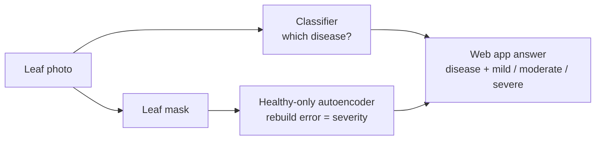

# MaizeCare

Maize feeds most of East Africa, and leaf diseases can wipe out a large part of a harvest. A farmer who spots a sick
leaf usually wants two answers: *what is this?* and *how bad is it?* MaizeCare answers both from a single phone
photo, in English or Kiswahili:

1. **Which disease?** A classifier (MobileNetV2, transfer learning) picks Healthy, Maize Leaf Blight (MLB), Maize
   Lethal Necrosis (MLND) or Maize Streak Virus (MSV). When it is unsure, it asks for a better photo instead of
   guessing.
2. **How severe?** An autoencoder trained only on healthy leaves tries to rebuild the leaf. The worse it rebuilds
   it, the more diseased the leaf. This gives a 0-1 severity score without any severity labels.

**New here?** [ARCHITECTURE.md](ARCHITECTURE.md) explains the system with simple diagrams.
[REPORT.md](REPORT.md) is the final report (problem, approach, results, limitations), and
[notebooks/maizecare.ipynb](notebooks/maizecare.ipynb) shows every step with the trained models.



## What is in this repository

| Deliverable | Where |
|---|---|
| Project overview, setup, how to reproduce | this README |
| Architecture diagram | above, and [ARCHITECTURE.md](ARCHITECTURE.md) |
| Disclosure of AI assistance | [AI_USE.md](AI_USE.md) |
| Data pipeline (scripted, reproducible) | [`src/maize/pipeline.py`](src/maize/pipeline.py), run with `maize-prepare` |
| Model training code | [`classifier.py`](src/maize/classifier.py), [`autoencoder.py`](src/maize/autoencoder.py), [`evaluate.py`](src/maize/evaluate.py) |
| Trained models (serialized) | [`release/`](release/): `classifier.onnx`, `classifier.json`, `model.onnx`, `calibration.json` |
| Dockerfile and docker-compose | [`Dockerfile`](Dockerfile), [`docker-compose.yml`](docker-compose.yml) |
| API service | [`src/maize/serve.py`](src/maize/serve.py) (FastAPI) |
| Final report | [REPORT.md](REPORT.md), with the figures in the [results notebook](notebooks/maizecare.ipynb) |

```
src/maize/
  preprocess.py   one photo -> model input + leaf mask; shared by training and the web app
  pipeline.py     the data pipeline (DataPipeline), the manifest and the image cache   (no torch)
  classifier.py   stage 1: Keras CNN, 4 backbones compared, exported to ONNX
  autoencoder.py  stage 2: masked convolutional and variational autoencoders, exported to ONNX
  evaluate.py     severity score calibrated on val, checked on test against A(x)
  serve.py        FastAPI app: /api/score + the built frontend                         (no torch)
frontend/         plain TypeScript UI (English + Kiswahili), compiled to static files
notebooks/        the results notebook (runs everything except training)
tests/            pytest suite
```

## Quick start: run the app

You need Docker and the four model files in `release/`.

```bash
docker compose up --build      # then open http://localhost:8000
```

Without Docker (Python 3.12+ and Node 24):

```bash
make install                   # the package with the data and serve extras, plus dev tools
make serve                     # builds the frontend and serves http://localhost:8000
make test                      # the test suite
```

Without model files the app still starts, and `/api/score` answers 503 until they are added.

## Reproduce everything from scratch

The data, the image caches and the trained models live on Google Drive, so a Colab session that dies loses
nothing. Training needs a GPU (an L4 was used); everything else runs on a CPU.

```bash
cd /content && git clone -b mask-and-severity https://github.com/Kos-en/maizecare repo && cd repo
pip install -q --no-deps -e . && pip install -q imagehash onnx onnxscript onnxruntime
export KERAS_BACKEND=torch D=/content/drive/MyDrive M=/content/drive/MyDrive/maize_models

maize-prepare $D/cv_datasets_cleaned $D                     # 1. data pipeline (CPU is enough)
maize-train-classifier $D $M                                # 2a. all 4 backbones -> $M/classifiers.csv
maize-train-autoencoder $D $M                               # 2b. conv + VAE      -> $M/autoencoders.csv
maize-evaluate $D $M $M/clf_mobilenet_v2                    # 3. calibrate on val, report on test
```

Then copy the four files the app needs into `release/` and commit them:

```bash
make release MODELS=<your maize_models folder> CLF=clf_mobilenet_v2 AE=v2/ae_<chosen kind>
```

Each command prints its usage line when run without arguments. Seeds are fixed (42) and the split is
deterministic, so the same photos give the same split and comparable models.

**Results without retraining:** open [`notebooks/maizecare.ipynb`](notebooks/maizecare.ipynb) in Colab
(File -> Upload notebook) and choose Runtime -> Run all. It reads the trained models from Drive and shows the
data, the exploratory analysis, both models, the test results and the full pipeline on test photos or your own.

## The data pipeline: `maize-prepare`

Every image goes through this before any training, and new photos get exactly the same treatment.

```bash
maize-prepare RAW ROOT       # RAW/<Class>/*.jpg; re-run after adding photos
```

1. **File check.** The file must open as a JPEG/PNG and its shortest side must be at least 50 px, otherwise it
   is marked `bad_image` or `too_small`.
2. **Near copies.** Two photos within 6 bits on **both** pHash and aHash are near copies, and chains of near
   copies form one group. (Either hash alone chained 18,624 unrelated photos into one group on the real data.)
3. **Mixed labels.** A group holding two classes is dropped whole (`label_conflict`); exact copies keep one
   (`duplicate_exact`).
4. **Split by group, stratified by class.** Within each class the groups are put in a fixed (hash) order and
   fill test, val and train until each holds 15% / 15% / 70% of that class. A near copy can never sit on both
   sides, and a leak check confirms it.
5. **Resize and leaf mask.** The longest side is scaled to 128 / 224 px and padded with black. The leaf is found
   with GrabCut grown out from the middle of the photo, keeping the piece that holds the middle and filling holes.
   Colour rules (Excess Green) were tried first and failed on field photos: the background is other leaves and
   weeds, and a yellowed leaf is less green than the weeds. Images and masks are cached on Drive in part files
   that are added, never overwritten (Drive served damaged data after a 1.5 GB file was overwritten repeatedly).

Only new files are read. Steps 2-4 are redone on the whole dataset every run, so the result never depends on the
order photos arrived. Unusable images stay in `manifest.csv` with their status.

## The models

- **Classifier.** Train the new head, then fine-tune the top 40 backbone layers. Class weights balance the
  classes, and blur / noise / brightness augmentation imitates field photos (no hue changes, because yellowing is
  the disease signal). The epoch with the best val macro-F1 is kept. `classifiers.csv` compares the backbones:
  pick on val, report on test.
- **Autoencoders.** A convolutional autoencoder and a VAE of the same shape: 4 stride-2 blocks (32 -> 256 filters)
  and a 1x1 code layer down to 32 channels (24x compression). The background is set to 0 and ignored by the loss.
  Trained on healthy train leaves only. `autoencoders.csv` compares them by how well their error separates healthy
  from each disease on val (AUROC, weakest disease first); the top row is used.
- **Evaluation.** The score is `s = clip((e - healthy median) / (diseased p99 - healthy median), 0, 1)`, set on
  val. On test, per disease: AUROC against healthy, and Spearman / scaled MAE against A(x), the share of the leaf
  in a symptom colour (as in Leaf Doctor / ASSESS). Two baselines get the same Spearman: 1 - P(healthy) from the
  classifier, and the colour distance from the average healthy leaf. Outputs: `calibration.json`,
  `metrics.json`, `test_scores.csv`, `error_by_class.png`, `heatmaps.png`.

## The web app and its API

Both models run as ONNX with `onnxruntime`, so the Docker image has no PyTorch, TensorFlow or Keras and fits
Render's free 512 MB.

| Endpoint | What it does |
|---|---|
| `GET /health` | `{"status": "ok", "model_loaded": true}` |
| `POST /api/score` | form field `file` (JPEG/PNG, up to 10 MB) -> label, confidence, `confident`, class probabilities, severity `score` 0-1, `within_healthy_range`, `leaf_fraction` |
| `GET /` | the web page |

```bash
curl -F file=@leaf.jpg http://localhost:8000/api/score
```

The page shows Healthy for a healthy label and otherwise grades the disease mild (< 0.35), moderate (< 0.70) or
severe, with advice. All text is in `frontend/public/i18n/{en,sw}.json`. The Kiswahili still needs a review by a
native speaker, and the advice a review by an extension officer. Photos are never stored. Monitoring is planned
in [docs/observability.md](docs/observability.md).

## Dependencies, CI and deployment

`pyproject.toml` is the only place dependencies are declared, split by use: the base (numpy, OpenCV) and the
`data`, `train` and `serve` extras, plus a `dev` group. `uv.lock` pins every package to an exact version and hash
(`make lock` refreshes it, taking only releases at least 7 days old). The Docker image installs just the `serve`
extra from the lock, so production runs exactly what CI tested.

On every push and pull request, `.github/workflows/ci.yml` runs ruff, pytest, `pip-audit` on the shipped
dependencies, `npm audit` and the frontend build. On a push to `main` it also builds the image, pushes it to
`ghcr.io/kos-en/maizecare` (tagged `latest` and the commit SHA) and tells Render to deploy that exact image.
Dependabot opens weekly update PRs.

One-time setup on Render (free plan):
1. Push to `main` once so the image exists in GHCR, then make the package public (GitHub -> Packages -> maize ->
   Package settings), or add GHCR credentials in Render.
2. Render -> New -> Web Service -> Existing image -> `ghcr.io/kos-en/maizecare:latest`, plan Free, health check
   path `/health` (or put the URL in `render.yaml` and use New -> Blueprint).
3. Copy the service's Deploy Hook URL (Settings) into the GitHub repo secret `RENDER_DEPLOY_HOOK_URL`.

Free instances sleep after 15 minutes idle, so the first request after that takes about a minute.

## Not built yet

From the proposal: the data source per image (Tanzania / Uganda) and results per source, bootstrap confidence
intervals and McNemar's test, Grad-CAM, by-eye severity ratings, and a quality gate in the app. The limitations
are discussed in [REPORT.md](REPORT.md).
